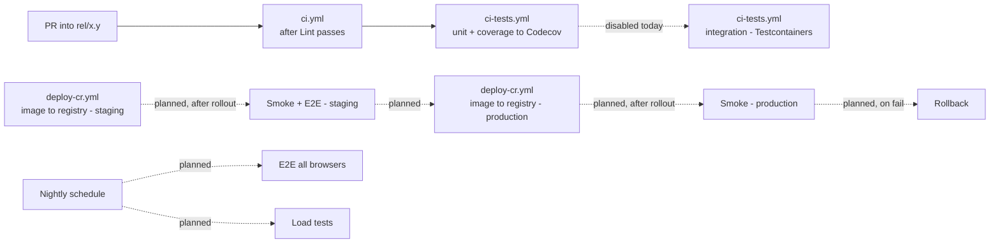

# Testing Strategy

> **Audience:** engineers and Claude Code working in this monorepo.
> **Status:** v0.2 draft. No decisions are open. A new item marked **[DECIDE]** (and listed in [§13](#13-open-decisions)) must be confirmed before it is implemented.
> **Rule for Claude Code:** follow this document when writing or changing tests. If a task conflicts with it, stop and ask rather than improvise.

---

## 1. Context and constraints

- TypeScript monorepo. Node.js/Express services, Vue frontend.
- Data layer differs by service: **Drizzle** in some services, **Knex** in others. Both target PostgreSQL.
- Multi-tenant SaaS with **SOC2 and HIPAA** obligations. PostgreSQL audit triggers use `SET LOCAL` context (`current_user_id`, `current_tenant_id`, `session_id`, `transaction_id`), with append-only audit tables and a `hard_delete_log`.
- Background jobs and events run on Kafka (`kafkajs`; see `apps/sample-queue-consumer`). Object storage is S3-compatible (MinIO locally).
- Integrates with third-party AI providers. The template's AI code (`apps/sample-a2a-mcp-rag`, through `@common/node-ai`) uses the OpenAI SDK; a downstream repo may add other providers. The AI rules in this document apply to every provider a repo uses.
- CI runs on GitHub Actions, on GitHub-hosted `ubuntu-latest` runners, which include Docker for Testcontainers. A downstream repo may move CI to a self-hosted runner (see [§11 runner notes](#runner-notes)). The current workflows, their triggers and required checks are documented in [docs/github.md#workflows](github.md#workflows) and [#ci](github.md#ci), the single source of truth. This document only adds where each test stage runs ([§11](#11-ci-pipeline)).
- **Deploy** in this document means building an app's image and pushing it to a container registry with `deploy-cr.yml`, for a chosen environment (staging or production). Rolling the new image out to the running service is platform-specific and outside this document (for example `deploy-sae.yml` for Alibaba Cloud SAE; other platforms in `docs/cloud/`). Vue frontends are deployed separately, to object storage with `deploy-bucket.yml`.
- **Out of scope:** AI output quality evaluation (prompt regression, answer accuracy). It needs real model calls and a labelled dataset, so it gets its own document, [AI_EVALUATION.md](AI_EVALUATION.md). Here, AI output is only checked for structure and failure handling ([§5.5](#55-other-dependencies), [§7](#7-e2e-testing-playwright)).

### Non-negotiables

1. **No real personal data or PHI in any test, fixture, snapshot, seed, recording, or log.** All test data is synthetic. Staging is never seeded from production copies.
2. **Tenant isolation is tested, not assumed.** Every tenant-scoped endpoint and repository needs a cross-tenant denial test (see [§6](#6-compliance-critical-test-suites-mandatory)).
3. **Audit behaviour is tested against real PostgreSQL**, never against mocks or PGlite.
4. **Load tests never run against production.**
5. **Tests must not call real AI providers** except in the explicitly marked smoke checks ([§8](#8-smoke-testing)).

---

## 2. Test types at a glance

| Type        | Purpose                                    | Tooling                                                                                   | Runs against                                                                   | When                          | Gates                                |
| ----------- | ------------------------------------------ | ----------------------------------------------------------------------------------------- | ------------------------------------------------------------------------------ | ----------------------------- | ------------------------------------ |
| Unit        | Pure logic, no I/O                         | `node:test`                                                                               | In-process                                                                     | Every push and PR             | PR merge                             |
| Integration | DB, S3, HTTP layer; Kafka and Redis mocked | `node:test` + PGlite (+ Testcontainers PostgreSQL for [§5.2](#52-drizzle-services) cases) | In-process; containers on the CI runner for [§5.2](#52-drizzle-services) cases | Every PR                      | PR merge                             |
| E2E         | User journeys through the Vue UI           | Playwright                                                                                | Staging                                                                        | After staging deploy; nightly | Production deploy                    |
| Smoke       | "Is the deploy alive?"                     | Playwright (`@smoke`) + HTTP checks                                                       | Staging, then prod                                                             | After every deploy            | Production deploy and rollback       |
| Load        | Capacity, latency, autoscaling             | k6                                                                                        | Staging, off-hours                                                             | Scheduled and on demand       | Release sign-off (advisory at first) |

---

## 3. Tooling standard

- **Test runner:** Node's built-in test runner (`node:test`, run with `node --test`) for backend services and shared packages. No Vitest or Jest. If any package uses one, migrate it ([§12](#12-implementation-checklist-in-order), step 2).
  - Assertions: `node:assert/strict`.
  - Mocks: `mock` from `node:test`, i.e. `mock.fn`, `mock.method`, `mock.timers`, and `mock.module` (needs `--experimental-test-module-mocks`; omit the `.ts` extension in the path).
- **Frontend (Vue apps and `common/compiled/vue`):** E2E tests only ([§7](#7-e2e-testing-playwright)). No component, composable or store unit tests, and no Vue Test Utils or DOM emulation. Plain JS shared with the frontend (`common/vanilla/iso`) is still unit-tested with `node:test`.
- **HTTP mocking (outbound):** MSW (`msw/node` in backend tests, `msw/browser` not used). Use it for AI providers and any third-party APIs.
- **HTTP testing (inbound):** `supertest` against the Express app instance. Never start a real listening port in unit or integration tests.
- **Postgres (default):** PGlite (`@electric-sql/pglite`), the same Postgres-in-WASM that `scripts/db-mocks` serves for local dev. Drizzle uses its PGlite driver; Knex connects through `@electric-sql/pglite-socket`. See [§5](#5-unit-and-integration-testing-by-data-layer) for what it may and may not be used for.
- **Containers:** `testcontainers` (Node) with the PostgreSQL and MinIO modules, only for what PGlite can't cover ([§5.2](#52-drizzle-services)) and for S3 ([§5.5](#55-other-dependencies)).
- **Kafka and Redis:** the in-process mocks `@js-ak/kafkajs-mock` and `ioredis-mock`, both already in `scripts/service-mocks`.
- **E2E and smoke:** `@playwright/test`.
- **Load:** k6.
- **Test data:** `@faker-js/faker` with a **fixed seed** per test file, wrapped in per-service factories.
- **Coverage:** Node's built-in coverage (`--experimental-test-coverage`) with the `lcov` reporter, uploaded to Codecov with flags per test type, the same way `ci-tests.yml` does today. Enforce minimums with `--test-coverage-lines`, `--test-coverage-branches` and `--test-coverage-functions`.

Pin versions in the lockfile. Before adding a dependency, check the current major version and use one that has been released for at least two weeks.

---

## 4. Repository layout and naming

```
apps/
  <service>/                # Express service
    src/**/foo.ts
    __tests__/
      unit/**/*.test.ts     # unit tests
      integration/**/*.test.ts # integration tests
      load/                 # k6 scripts and scenarios for this service
      factories/            # synthetic data builders for this service
      setup/                # container bootstrap, DB helpers
  <vue-app>/                # Vue app: no unit or component tests
    __tests__/
      e2e/                  # Playwright specs, fixtures, page objects
        smoke/              # @smoke-tagged specs
common/
  compiled/node/utils-tests/ # shared helpers: tenant context, auth tokens, MSW handlers, faker seeding
  */**/__tests__/           # common/* packages keep tests next to the module they cover
```

**Folders decide which suite runs a test.** Every app keeps its tests in `apps/<app>/__tests__/`, never inside `src/`. The folder split means a unit glob never picks up an integration file.

| Location                                        | Suite            |
| ----------------------------------------------- | ---------------- |
| `apps/<app>/__tests__/unit/**/*.test.ts`        | unit             |
| `apps/<app>/__tests__/integration/**/*.test.ts` | integration      |
| `apps/<vue-app>/__tests__/e2e/**/*.spec.ts`     | E2E (Playwright) |
| `apps/<service>/__tests__/load/**/*.js`         | load (k6)        |

There is no runner config file. Each workspace's npm scripts choose a suite by the files they pass to `node --test`. A workspace defines only the scripts it needs; `npm run test:workspaces` and CI run them with `--if-present`, so a missing script is skipped, not an error.

| Script             | Command                                                                                                                                    |
| ------------------ | ------------------------------------------------------------------------------------------------------------------------------------------ |
| `test:unit`        | `node --test-reporter=spec --experimental-test-coverage --experimental-test-module-mocks --test --test-only ./__tests__/unit/**/*.test.ts` |
| `test:integration` | `node --test-reporter=spec --test --test-only --test-isolation=process --test-concurrency=1 ./__tests__/integration/**/*.test.ts`          |
| `test:schemas`     | validates the workspace's zod schema exports with the root `scripts/test-schemas.ts`; currently stubbed to `exit 0`                        |
| `test:e2e`         | Vue apps only: Playwright against `__tests__/e2e/` ([§7](#7-e2e-testing-playwright))                                                       |
| `test`             | `npm run test:unit && npm run test:integration && npm run test:schemas`                                                                    |

`--test-only` is used in `apps/*`, so only tests marked `.only()` run there (see `.claude/CLAUDE.md`). Keep `--test-reporter=spec` in `test:unit`: `ci-tests.yml` relies on it to add coverage reporting.

---

## 5. Unit and integration testing by data layer

### 5.1 What belongs where

- **Unit:** validation (Zod schemas), mappers, pricing/limits logic, permission checks, prompt-building functions, error translation. Inject dependencies; do not mock the ORM.
- **Integration:** repositories, migrations, transactions, audit triggers, tenant context middleware, queue workers, S3 interactions, full HTTP request → DB round trips.

Rule of thumb: if a test needs to mock the ORM or SQL to pass, it is an integration test and belongs on a real database.

### 5.2 Drizzle services

- **Default (PGlite):** repository queries, migrations, transactions and HTTP → DB round trips run on PGlite with Drizzle's PGlite driver. Migrations are applied with Drizzle's migrator at the start of each test file.
- **Must use Testcontainers PostgreSQL instead of PGlite** (Drizzle and Knex alike): audit logging (all of [§6.2](#62-audit-logging-testcontainers-postgresql-only)), `SET LOCAL` context, roles and grants, row-level security, extensions PGlite doesn't ship, concurrency or locking behaviour, and anything connection-pool related. PGlite is a single connection with a single user, so it can't show these faithfully.
- Apply migrations with the same command CI uses for real environments, so migration drift fails tests.

### 5.3 Knex services

- **Default (PGlite):** the test file starts a `@electric-sql/pglite-socket` server on a free port, and Knex connects to it with the `pg` driver and a pool of one connection (PGlite serves one connection at a time).
- Run `knex migrate:latest` at the start of each test file, against PGlite or, for the [§5.2](#52-drizzle-services) cases, the container.
- The audit trigger and `SET LOCAL` middleware tests from the audit logging implementation guide run on Testcontainers PostgreSQL ([§6.2](#62-audit-logging-testcontainers-postgresql-only)).

### 5.4 Database isolation between tests

- **PGlite:** each test file creates its own in-memory instance, so files are isolated with no shared state.
- **Testcontainers:** start **one PostgreSQL container per test run** in a global setup module passed with `--test-global-setup`, only when the run includes [§5.2](#52-drizzle-services) cases. Give each test file its own database, because `--test-isolation=process` runs each file in its own process: create it in a `before` hook from a migrated template (`CREATE DATABASE <file_db> TEMPLATE app_template`), and drop it in `after`.
- Within a test, prefer **transaction-per-test with rollback**. Audit tests that need committed rows or several transactions use truncate-after-test instead, and must be marked with a comment saying why.
- Never rely on test execution order.

### 5.5 Other dependencies

- **Kafka:** no real broker in tests.
  - Unit-test a consumer by calling its message handler with a constructed message, and mock the queue repository with `mock.module()`, as `apps/sample-queue-consumer` does.
  - Each topic gets one integration test that produces and consumes a message through the in-process mock `@js-ak/kafkajs-mock` (already in `scripts/service-mocks`).
  - The mock doesn't reproduce broker behaviour such as consumer-group rebalancing or offset commits, so don't test those here.
- **Cron:** `apps/cron` is triggered over HTTP by an external scheduler, so test its routes like any other endpoint. Use `mock.timers` for time logic.
- **Redis:** `ioredis-mock` in place of a real server, swapped in where the Redis client is created (`common/compiled/node/services/db/redis.ts`). It runs in-process and doesn't reproduce cluster, persistence or eviction behaviour, so don't test those here.
- **S3:** Testcontainers MinIO. Create a fresh bucket per test file.
- **AI providers:** MSW handlers in `common/compiled/node/utils-tests/`, returning recorded **synthetic** responses. Cover success, rate limiting (429), timeouts, malformed output, and content-filter refusals. Never record fixtures from conversations containing real customer data.

### 5.6 API contracts

The Vue apps rely on the services' documented API, so the services prove they match it. There are no consumer-side contract tests; the Vue side is covered by E2E ([§7](#7-e2e-testing-playwright)).

- **Responses match their schema:** in integration tests, every response body is validated with the zod response DTO for that route (`Schema.parse(body)`). This is the same schema the app's OpenAPI spec is generated from, so a response that drifts from the documented shape fails the test.
- **The spec matches the code:** CI regenerates each OpenAPI spec and fails if it differs from the committed YAML. That's `docs:generate` in `db/*`; for apps, `scripts/generators/api-generator-route.ts` (see the `openapi-docs` skill).

---

## 6. Compliance-critical test suites (mandatory)

These suites are required for SOC2/HIPAA evidence. A PR that adds a tenant-scoped endpoint, table, or mutation without the matching tests must not merge.

### 6.1 Tenant isolation

For every tenant-scoped endpoint and repository method:

- A user from tenant A **cannot read, list, update, or delete** tenant B's records. Expect `404`, the same response as a record that doesn't exist, so the API never reveals that a record exists in another tenant. Tenant-scoped queries filter by tenant, so this is what they return anyway. `403` is only for role and permission checks (`requireRole`, `requireFga`), never for another tenant's records.
- List endpoints never return rows from another tenant, including with filters, pagination cursors, or search.
- Background jobs carry tenant context and cannot process another tenant's data.
- S3 object keys are tenant-prefixed, and signed URLs cannot be used across tenants.

Implement this as a reusable helper (for example `assertTenantIsolation(endpoint, factories)`) in `common/compiled/node/utils-tests/` so each endpoint needs only a few lines.

### 6.2 Audit logging (Testcontainers PostgreSQL only)

- Every insert, update, and soft delete on an audited table writes an audit row with the correct `current_user_id`, `current_tenant_id`, `session_id`, and `transaction_id`.
- `SET LOCAL` context does not leak between requests or pooled connections. Run two requests on the same pooled connection with different tenants and verify each audit row.
- `UPDATE` and `DELETE` on audit tables fail (append-only enforcement).
- Hard deletes write to `hard_delete_log`.
- Every table listed in `audit_registry` has its trigger installed. This is a single test that queries the catalog and compares it with the registry.

### 6.3 Authentication and authorization

- Expired, malformed, and wrong-audience tokens are rejected.
- Role-based permissions are covered with a table-driven test per resource (role × action → allowed/denied).
- Rate limiting and API key checks on public endpoints (including the MCP server) are exercised.

### 6.4 Sensitive data handling

- Logs and error responses do not include request bodies or fields marked sensitive. Assert on captured logger output.
- If an app handles requests from people to access or correct their personal data (required by many data-protection laws), that handling has end-to-end integration coverage.

---

## 7. E2E testing (Playwright)

- Runs against **staging** once the new image is running there, and nightly.
- Browsers: Chromium on every run; Firefox and WebKit nightly.
- **Test tenants** are seeded through an API or seed script before the run, never through the UI. Use dedicated synthetic tenants (for example `e2e-tenant-a`, `e2e-tenant-b`), which are reset at the start of each run.
- Authenticate once per role and tenant using Playwright `storageState`. Do not log in through the UI in every test (keep one dedicated login test).
- Use page objects in `apps/<vue-app>/__tests__/e2e/pages/`. Select elements with `data-testid` or accessible roles, never with CSS classes.
- Include at least one cross-tenant check through the UI (direct URL to tenant B's resource while logged in as tenant A).
- AI features: assert on structure and UI state, not exact generated text.
- Retries: 2 in CI, 0 locally. A test that passes only on retry is reported as flaky ([§10](#10-test-data-and-flakiness-policy)).
- Artifacts: traces, screenshots, and videos on failure only. They must contain only synthetic data, and CI keeps them for **14 days** (`retention-days: 14` on the upload step).

---

## 8. Smoke testing

Smoke tests are a small, fast subset (under 3 minutes) tagged `@smoke` that decides whether a deploy is healthy.

- **Staging:** runs once the new image is running in staging, and gates E2E and the production deploy.
- **Production:** runs once the new image is running in production, using a dedicated synthetic smoke tenant. A failure fails the job and alerts; rollback is **manual**. Someone rolls the platform back to the previous image tag, which is still in the registry, so nothing is rebuilt.
- **Image tags:** staging and production deploys use a unique tag, the release tag from `release.yml` (e.g. `apps-sample-api-v1.2.3`) or the commit SHA, never `latest`. Pushing `latest` overwrites the previous image, which leaves nothing to roll back to.

Checks:

1. `GET /health` (liveness) and `GET /health/ready` (readiness: DB, Redis, and S3 reachable) on every service, served by `healthRouter` in `common/compiled/node/health/`.
2. Log in as the smoke tenant user and load the main dashboard.
3. One read and one write on a core resource, then clean up.
4. Produce a no-op message to a smoke topic and confirm its consumer processed it.
5. One minimal call per AI provider in use, verifying connectivity only. This is the **only** place tests call real AI providers, and it must use a fixed synthetic prompt.

Smoke tests in production must be safe to repeat and must not create data visible to real tenants.

---

## 9. Load testing (k6)

- **Environment:** staging, on a schedule outside working hours and never while staging smoke or E2E runs ([§7](#7-e2e-testing-playwright)–[8](#8-smoke-testing)), so neither disrupts the other. Scale staging to production-like sizing for the run if the platform allows. Never production. If results are skewed by staging's size, or the runs disrupt staging, move load tests to a dedicated performance environment.
- **Where k6 runs:** inside the same private network and region as the environment under test (for example your cloud VPC), so latency reflects the service rather than the internet, the environment doesn't have to be public, and no tenant-like traffic or data leaves the region. GitHub-hosted runners can't do this, so the load job runs on a self-hosted runner or a dedicated instance in that network ([§11 runner notes](#runner-notes)).
- **Scenarios** live in `apps/<service>/__tests__/load/`, next to the service they load. A scenario that spans several services goes in the app that is the entry point for that traffic, usually the API the frontends call:
  - _Baseline:_ expected normal traffic across a mix of tenants.
  - _Peak:_ 2–3× baseline.
  - _Noisy neighbour:_ one tenant generating heavy load while others are measured, to check that per-tenant rate limiting protects them.
  - _Soak:_ baseline for 1–2 hours, to detect memory leaks and connection-pool exhaustion.
  - _Queue burst:_ a large Kafka produce spike, to check consumer throughput and how fast consumer lag drains.
- **AI providers are stubbed** during load tests (a mock endpoint in the same network, with the services' AI provider base URLs pointed at it; the OpenAI SDK reads `OPENAI_BASE_URL`) unless a provider capacity test is explicitly planned and budgeted.
- **Thresholds:**
  - **Until two baselines exist:** p95 API latency < 500 ms for non-AI endpoints, error rate < 1%, and zero failed audit writes. These are starting values and advisory only.
  - **After that:** p95 latency and error rate may not be more than 20% worse than the baseline, and failed audit writes stay at zero. AI endpoints are excluded from latency limits, because they hit the stub.
- Record the platform's instance counts and autoscaling events alongside k6 results.
- Results are advisory until two baseline runs exist; after that, threshold breaches block release sign-off.

---

## 10. Test data and flakiness policy

### Test data

- All data comes from per-service factories built on faker with a fixed seed.
- Generated identifiers (names, emails, phone numbers, national ID numbers, medical fields) must be clearly synthetic. Use reserved domains such as `example.com` for email.
- Snapshot tests must not capture timestamps, IDs, or anything resembling personal data. Use inline snapshots for small structures only.

### Flakiness

- Unit and integration tests: **no retries.** A flaky test is a bug and is fixed or quarantined.
- Quarantine by tagging with `.skip` plus a linked issue and owner. Quarantined tests are reviewed weekly and removed or fixed within two weeks.
- Never use arbitrary sleeps. Use fake timers, polling helpers with timeouts, or Playwright's auto-waiting.

---

## 11. CI pipeline

This shows only where each test stage runs. Lint, quality gates, releases and deploys are described in [docs/github.md](github.md#workflows).



Solid arrows run today. Dashed arrows are disabled or not built yet: [§12 step 6](#12-implementation-checklist-in-order) re-enables integration, and steps 8–10 add the rest. "Rollout" means the platform restarting the service on the new image (for example `deploy-sae.yml` on SAE), which is outside this document.

### Downstream-only workflows

Workflows a downstream repo adds (for example the smoke and E2E gates from [§12 step 9](#12-implementation-checklist-in-order), or the load job from step 10) use the `local-` prefix, such as `.github/workflows/local-load.yml`, so the upstream sync doesn't overwrite them ([docs/github.md#sync-upstream-template](github.md#sync-upstream-template)).

### Gates

| Stage                  | Blocks                                   | Status                                                                                                     |
| ---------------------- | ---------------------------------------- | ---------------------------------------------------------------------------------------------------------- |
| Unit tests             | PR merge into `rel/x.y`                  | today (`ci-tests.yml`)                                                                                     |
| Integration tests      | PR merge into `rel/x.y`                  | planned: step disabled in `ci-tests.yml`, re-enable in [§12 step 6](#12-implementation-checklist-in-order) |
| Codecov patch coverage | PR merge into `rel/x.y`                  | planned: needs a `codecov.yml` with status checks ([§12 step 6](#12-implementation-checklist-in-order))    |
| Staging smoke + E2E    | Production deploy                        | planned ([§12 steps 8–9](#12-implementation-checklist-in-order))                                           |
| Production smoke       | Triggers rollback                        | planned ([§12 step 9](#12-implementation-checklist-in-order))                                              |
| Load                   | Release sign-off (after baselines exist) | planned ([§12 step 10](#12-implementation-checklist-in-order))                                             |

Lint, type check and security gates (CodeQL / Semgrep and others) are listed in [docs/github.md#workflows](github.md#workflows).

### Coverage targets

- **Patch coverage** (new and changed lines): 80%, enforced by Codecov. Blocks PRs from [§12 step 6](#12-implementation-checklist-in-order).
- **Project coverage:** must not drop more than 1% per PR; ratchet upward. Blocks PRs from [§12 step 6](#12-implementation-checklist-in-order).
- **Critical modules** (auth, tenant context middleware, audit helpers, permission checks): 90% line and branch coverage. This is the exit criterion for [§12 step 5](#12-implementation-checklist-in-order), and it blocks PRs only once that step is done. Today most of these modules have no direct coverage (for example `common/compiled/node/auth/*`).
- Upload separate Codecov flags (`unit`, `integration`) so each suite's contribution is visible.

### Runner notes

- Pin image tags to the same major versions as production databases.

GitHub-hosted runners (the default) start clean for every job, with Docker available, so nothing else is needed. If you move CI to a **self-hosted runner** (for example inside your cloud VPC):

- Testcontainers needs a Docker-compatible socket. If the runner uses Podman, set `DOCKER_HOST` to the Podman socket; rootless Podman usually also needs `TESTCONTAINERS_RYUK_DISABLED=true`, with explicit container cleanup in the `globalTeardown` export of the `--test-global-setup` module.
- Mirror the container images used in tests (Postgres, MinIO, Playwright) into your cloud's container registry and reference them from there. This avoids Docker Hub rate limits and pulls from outside the VPC.
- Clean up dangling containers and volumes after each job, so runs don't interfere with each other.

---

## 12. Implementation checklist (in order)

Claude Code should work through these in order, one PR per step unless steps are trivially small.

1. **Inventory:** list every package and its current test setup (runner, existing tests, ORM, DB engine). Write the result to `docs/TEST_INVENTORY.md`. Make no changes yet.
2. **Standardize on `node:test`:**
   - Migrate any Vitest or Jest packages.
   - Give every backend and shared workspace the npm scripts `test:unit`, `test:integration` and `test` (both).
   - Keep the `--test-reporter=spec` flag that `ci-tests.yml` relies on for coverage.
   - Move tests that live elsewhere into `apps/<app>/__tests__/{unit,integration}/`. Today that's `sample-queue-consumer` and `sample-rest-app-v2`, which use `src/__tests__/`; update their test scripts and `tsconfig.json` `include` with the move.
3. **Shared test utilities:** extend `common/compiled/node/utils-tests/` (next to the existing `http-mocks` and `http-request`) with seeded faker, tenant/user factories, auth token helpers, and MSW handlers for each AI provider.
4. **Integration harness:**
   - PGlite harnesses for Drizzle (in-process driver) and Knex (`pglite-socket`), one instance per test file.
   - The Kafka and Redis mocks.
   - A Testcontainers global setup (`--test-global-setup`) for PostgreSQL (the [§5.2](#52-drizzle-services) cases) and MinIO, with per-file databases from a migrated template.
5. **Compliance suites:** tenant isolation helper and tests ([§6.1](#61-tenant-isolation)), audit trigger tests ([§6.2](#62-audit-logging-testcontainers-postgresql-only)), and auth/permission tests ([§6.3](#63-authentication-and-authorization)) for existing endpoints. Done when the critical modules reach 90% line and branch coverage ([§11](#11-ci-pipeline)); from then on, that target blocks PRs.
6. **CI wiring:** in `ci-tests.yml` (called by `ci.yml`):
   - Re-enable the integration step (remove `false &&` from its `if:`) once the Testcontainers harness from step 4 works.
   - Add Codecov flags per suite.
   - Add a `codecov.yml` with the coverage thresholds as status checks.
   - Add the OpenAPI drift check ([§5.6](#56-api-contracts)): regenerate each spec and fail if it differs from the committed YAML.
   - If CI runs on a self-hosted runner, set it up as described in [§11 runner notes](#runner-notes).

   The commented-out E2E step in `ci-tests.yml` is replaced by step 8.

7. **Health endpoints:** make sure every service mounts `healthRouter` (`/health`, `/health/ready`), and that the readiness checks in `common/compiled/node/health/checks/` cover each dependency the service uses.
8. **Playwright:** set up `apps/<vue-app>/__tests__/e2e/` with staging config, seed script for E2E tenants, `storageState` auth, page objects, the first core journeys, and the `@smoke` subset. `apps/sample-vue-full/__tests__/e2e/` is the reference layout.
9. **Deployment gates:** run staging smoke and E2E once the image pushed by `deploy-cr.yml` (environment `staging`) is running, and production smoke once the production image is running; a production smoke failure alerts for a manual rollback ([§8](#8-smoke-testing)). Deploy with a unique image tag, not `latest`. The rollout step itself stays platform-specific. Name any new workflow as in [§11 Downstream-only workflows](#downstream-only-workflows).
10. **Load testing:** add k6 scenarios under `apps/<service>/__tests__/load/`, an AI provider stub in the same network as the environment under test, and a scheduled workflow whose load job runs on a runner inside that network; run two baselines, then set thresholds. Name the workflow as in [§11 Downstream-only workflows](#downstream-only-workflows).
11. **Documentation:** update this file's status, resolve any new **[DECIDE]** items, and add a short "how to run tests locally" section.

---

## 13. Open decisions

None open. When a new question comes up, add a row here (`#`, decision, section) and mark it **[DECIDE]** where it appears in the text.
